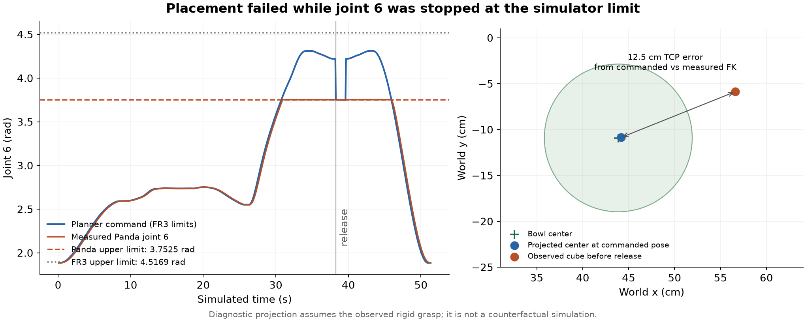
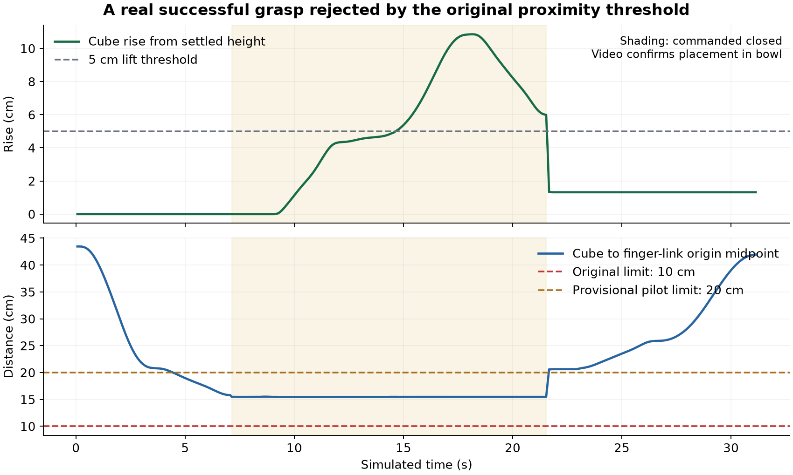

# TiPToP baseline execution and failure analysis — November 5, 2026

**Status: pilot complete; paper suite attempted but limited by Gemini quota.** The pilot returned
and executed 15/15 plans, produced 11/15 stable lifts (73%), and completed 9/15 tasks (60%).
The larger suite executed five plans, with three stable lifts and three completed tasks; 35 other
attempts were blocked by the model API daily quota. These are infrastructure failures, not robot
failures. A separate cached-scene Panda-model diagnostic is documented below.

## What caused the delay

The original A6000 host ran driver 595.91.07. Isaac Sim 5.0.0.0 crashed with exit 139 in
`librtx.scenedb.plugin.so!carbOnPluginStartup`, before scene creation, even in a minimal app.
Missing container libraries were fixed first, but did not resolve that crash. The failure matches
NVIDIA's reported R595/older-Kit incompatibility; the available A6000 host driver could not be
changed inside the container. Attempts to obtain an older-driver A6000 or L40S found no capacity.
[NVIDIA issue](https://github.com/isaac-sim/IsaacSim/issues/619).

The working deployment uses a Blackwell host with driver 590.48.01 for the original simulator,
with Torch's CUDA 12.8 build. TiPToP and M2T2 remain on the A6000 in their original environments.
This established actual camera rendering, all five scene inspections, replay and fresh robot trials.
Isaac Sim 6.x migration experiments were unsuccessful and are excluded from the baseline.
[Earlier startup records](startup_diagnostics_20261104.md).

The Google credential was valid: model lookup, a generation request and real planning calls passed.
The simulator host has no Google key, so its local credential-presence WARN is expected. Model access
was verified on the planner host. Two SSH loopback forwards carry the planner service traffic.

The later paper run received `429 RESOURCE_EXHAUSTED` with
`generativelanguage.googleapis.com/generate_content_free_tier_requests`, limit **20** for
`gemini-robotics-er-2-preview`. No key replacement or GPU upgrade resolves that project quota.
The evidence is retained in paper-run records and sanitized server logs. The original scheduler
continued because HTTP health checks still passed; it spent approximately 40 seconds per rejected
attempt. A regression-tested circuit breaker now stops before scheduling another simulator after
a quota/rate-limit response. No Google billing change or model substitution was made.

## Tested environment and provenance

| component | verified configuration |
|---|---|
| simulator GPU | RTX PRO 6000 Blackwell Max-Q Workstation Edition, 97,887 MiB, driver 590.48.01 |
| planner GPU | RTX A6000, 46,068 MiB, driver 595.91.07 |
| OS / simulator container | Ubuntu 22.04; `nvidia/cuda:12.8.1-devel-ubuntu22.04` |
| simulator | Isaac Sim 5.0.0.0, Isaac Lab 2.2.0, Python 3.11.18 |
| simulator Torch | 2.7.0+cu128; torchvision 0.22.0+cu128; `UV_NO_SYNC=1` |
| TiPToP | `d8f5afdaa94a7432220c3042f9f80be5ab45aae8`; Torch 2.7.1 / CUDA 12.9 |
| M2T2 | `96201acdb77baa1bc9d01bdf4d6f870d79b4b696`; Torch 2.4.1 / CUDA 12.0 |
| cuRobo / cuTAMP | `b5fad1df2a3ac4d3e33e369918b7d62d0e59ebd1` / 0.0.6 |
| simulator source | `69a914cf56e0da6adafe9428de39b6ceffe9bcc6`, no tracked source changes |
| experiment harness | `e4bb12239c0f5e52820e57320bd6bb582d159665`, clean during baseline execution |
| Gemini | `gemini-robotics-er-2-preview`, `thinking_level=MINIMAL` |

- [Simulator machine record](../provenance/machine_8b05bbe8ecc9.txt)
- [Planner machine record](../provenance/machine_f60c32cab1a2.txt)
- [Planner dependency and checkpoint provenance](../provenance/provenance_planner_with_sam2_20261105.txt)
- [Split-host run provenance](../provenance/split_host_20261105.json)
- [Successful five-scene preflight](../results/preflight_20261105T050641Z.json)
- [Commands to reproduce this deployment](runpod_reproduction.md)

The chosen asset archive contains all 51 configured scenes; SHA-256
`b791aef3585fea0b56605e9ac847970d399866e909f8349f358749321fb9567d`.
The SAM2.1 large checkpoint was downloaded during the fresh smoke, then hashed:
`2647878d5dfa5098f2f8649825738a9345572bae2d4350a2468587ece47dd318` (898,083,611 bytes).
Per-run metadata and `git.diff` retain the exact upstream patch and copied configuration.

## Geometry, model and timing checks

The cube is approximately **7.21 cm** across, rather than the runbook's approximate 6 cm.
Both `left_inner_finger` and `right_inner_finger` bodies exist. The evaluator uses their origin
midpoint, which is offset substantially from the contact region. Scene 4 contains two cans;
scene 5 contains five blocks and requests any three in the bowl. All goal/body mappings in
[scenes.json](../configs/scenes.json) were filled from live inspections.

Some scene-4/5 mesh centers are offset from their rigid-body origins (the scene-4 cube has a
local z offset near 20 cm). Direct mesh-vertex inspection confirmed real asset transforms.
The evaluator preserves raw body poses and additionally records geometry-box centers, using
those centers for lift height, proximity, target matching and perception comparisons. Whole-task
checks transform the full geometry box. No asset or physical state was changed to correct scoring.

FR3-versus-Panda grasp-frame FK agrees at all 467 measured configurations in the successful smoke:
zero translation difference and less than 0.000003 degrees orientation difference. The measured
finger reference sits about 12.93 cm behind that TCP in its local z direction. This is not a
complete direct USD link-by-link FK validation.

**Joint limits differ despite matching FK.** Direct inspection of the simulator USD and pinned
planner URDFs gives:

| joint | simulator Panda upper limit | planner FR3 upper limit |
|---|---:|---:|
| 6 | 3.7525 rad | 4.5169 rad |
| 7 | 2.8973 rad | 3.0159 rad |

[Simulator limits](../provenance/simulator-joint-limits_20261105.json) ·
[Planner limits](../provenance/planner-joint-limits_20261105.json).

The recorded plan interpolation interval is 0.02 s. Subsampling by 3 at 15 Hz produces about
1.111 times the planned duration. The client camera's existing −1.5 cm world-z adjustment and
all original execution timing are preserved. The pinned default configuration uses
`time_dilation_factor=0.2`; the paper reports 0.6, another reason these current-code simulation
results should not be presented as an exact reproduction of its published hardware trials.
[Paper implementation details](https://arxiv.org/html/2603.09971v2#A3).

## Smoke tests

| check | result |
|---|---|
| M2T2 sample | 515 predicted grasps |
| cuTAMP sample | successful three-object plan; first solution about 2.79 s |
| original saved-plan replay | 450 frames / 30 s, exit 0; cube remains on table in reviewed frames |
| fresh end-to-end smoke | valid nine-step plan, 467 executed control steps, cube placed in bowl |

The fresh smoke recorded 22.63 s planning and 176.91 s wall duration; scheduling to record finish
was 185 s. Device peaks during that interval were 10,394 MiB on the simulator and 7,245 MiB on
the planner. These are device-wide sampled peaks, not isolated process allocations. Later pilot
trials used less simulator memory. Summing separate-host peaks is an upper bound, not proof of
a tested single-host deployment.

[Smoke summary](../results/preflight_smoke_20261105T045535Z/summary.md) ·
[Video review](../results/preflight_smoke_20261105T045535Z/review.html) ·
[Trace/resource audit](../results/preflight_smoke_20261105T045535Z/measurement_audit.json).

## Scoring validation

The original 10 cm proximity limit incorrectly rejected the visually successful smoke. Its held
cube was 15.467–15.479 cm from the inner-finger origin midpoint. Rescoring the same immutable trace
with 20 cm gives a 10.855 cm maximum rise and 6.867 s continuous hold. A correction in
`manual_labels.csv` preserves the raw record.

| parameter | pilot value | status |
|---|---:|---|
| minimum rise | 0.05 m | frozen 2026-11-05 06:04:57 UTC |
| minimum continuous hold | 0.5 s | frozen 2026-11-05 06:04:57 UTC |
| maximum center-to-finger-origin distance | 0.20 m | frozen 2026-11-05 06:04:57 UTC |

All 15 pilot outcomes were reviewed. Positive hold times range from 1.333 to 11.133 s; negative
maximum rises range from 3.42 to 10.68 mm. Proximity limits 17.5, 20 and 22.5 cm each give 11/15
stable lifts; 10 cm gives 0/15 and 15 cm gives 1/15. The largest raised-and-closed distance is
18.41 cm. One positive reaches only 5.132 cm rise, so the height cutoff remains sensitive in that
case. No dwell, retry or artificial attachment was added. The paper command explicitly passes
these frozen values. [Freeze record and hashes](../provenance/scoring_frozen_20261105.json).

## Pilot results

Scene 1, variants 0–4, three trials each: **15/15 complete**, from 05:06:41 to 05:54:56 UTC
(48.25 minutes including attribution). All 15 returned a plan and executed without a harness exception.

| metric | result | 95% Wilson interval |
|---|---:|---:|
| stable lift / scheduled | 11/15 (73%) | 48–89% |
| completed task / scheduled | 9/15 (60%) | 36–80% |

Variant 4 missed all three grasps. Variant 0 missed one of three. Variant 2 lifted successfully in
all three trials but completed only one task, exposing the two distinct placement mechanisms above.
Variant 3 completed all three under the stated task criterion, including one tilted-bowl boundary case.

The median schedule-to-record duration was 2.80 minutes (range 2.47–4.00); recorded evaluator wall
time excludes some startup and had median 2.67 minutes. Planning median was 9.98 s, range 8.79–20.77 s.
Sampled device peaks were 7,513 MiB simulator and 7,791 MiB planner. Their summed upper bound is
15,304 MiB, comfortably below 48 GiB, although this deployment used two hosts.

[Summary](../results/pilot_scene1_20261105/summary.md) ·
[Portable video review](../results/pilot_scene1_20261105/review.html) ·
[Reviewed labels](../results/pilot_scene1_20261105/manual_labels.csv) ·
[Final resource audit](../results/pilot_scene1_20261105/resource_audit_final.json).

## Paper-suite results

Target: scenes 1–5, first four variants each, two trials (40 intended). Started at 06:05:03 UTC with
`--max-hours 2.6` and the frozen criteria. [Paper provenance](../provenance/paper_split_host_20261105.json).
The suite ended at **06:47:29 UTC**, after 42.43 minutes. All 40 attempts have immutable records,
but only five executed a plan: scene 1 variants 0–3, and scene 2 variant 2 on its second trial.
The first quota rejection occurred at attempt 004; attempt 026 subsequently succeeded, while all
other remaining attempts were rejected. The account's precise quota-reset behavior was not established.

| measured outcome | count |
|---|---:|
| executed plans | 5/40 scheduled |
| API-quota rejections | 35/40 scheduled |
| stable lift among executed plans | 3/5 (60%; 95% Wilson 23–88%) |
| task completion among executed plans | 3/5 (60%; 95% Wilson 23–88%) |
| reviewed robot failures | 2 missed M2T2 grasps |

The two misses reach only 1.21 and 1.65 cm rise; video shows empty carries. Two cubes are placed
in bowls and one can in a mug. The can task succeeds despite a joint-7 command exceeding the
simulator's negative limit by 0.117 rad, so a limit violation does not automatically imply task failure.
Median executed-run wall time was 158.74 s (150.41–213.80); scheduling-to-finish median 166 s
(159–222), planning median 10.18 s (9.73–13.18). Device peaks were 6,657 MiB simulator and
8,961 MiB planner. The planner peak includes overlap with the separate replanning diagnostic.

Six quota-blocked scene-4 attempts (variants 1–3, both trials) also show the cube below the table
at initialization, at approximately z = −218 m. Variant-0 inspections had not exposed this.
These variants need an asset/placement check before a future scene survey. (Found November 6: the released
files author the cube's mesh 20 cm below its body in exactly these three variants, so it starts under the
tabletop; `scripts/fix_scene_assets.py` repairs them, see `patches/README.md`.) No valid task outcomes
are claimed for scenes 3–5. The 3/40 scheduled success count is a service-availability outcome,
not an estimate of the robot's task competence across all five scenes.

[Reviewed summary](../results/paper_20261105/summary.md) ·
[Portable video review](../results/paper_20261105/review.html) ·
[Labels](../results/paper_20261105/manual_labels.csv) ·
[Trace/resource audit](../results/paper_20261105/measurement_audit.json).

The paper's failure figure describes 173 separate DROID hardware trials with different tasks.
This suite evaluates the five released simulation scenes; compare failure mechanisms, not raw
success percentages as if the populations were matched.
[Paper failure-analysis methods](https://arxiv.org/html/2603.09971v2#S7.SS3).

## Failure evidence already established

- **Execution/model mismatch, pilot `002_s1v2_baseline_t0`:** the grasp is stable for over 11 s,
  with less than 0.5 mm in-hand shift. Immediately before release, joint 6 is commanded to
  4.219 rad but saturates at 3.7525 rad. Commanded-versus-measured FK gives 12.46 cm TCP error.
  Projecting the observed rigid grasp onto the commanded pose puts the cube over the bowl;
  the actual cube is released beside it. The bowl itself moves less than 0.15 mm. Joint 7 also
  exceeds its limit. This is labeled execution failure, not unstable grasp. The projection is
  a diagnostic calculation, not a counterfactual simulation.
  [Measurements](../results/pilot_scene1_20261105/placement_fk_diagnostic.json).
- **Missed M2T2 grasp, pilot `004_s1v4_baseline_t0`:** video shows closure at the cube edge,
  then an empty carry; maximum cube rise is 7.94 mm. No commanded arm joint limit is exceeded.
  This is a genuine grasp failure under the validated height criterion.
- **Grasp-transform change, pilot `007_s1v2_baseline_t1`:** FK from the first close command
  shows the cube shifting 6.84 cm and rotating 112.1 degrees relative to the TCP before release.
  The arm's joint tracking error is only 0.006 rad near release, with no joint-limit violation.
  A rigid-grasp projection from first closure puts the cube over the bowl; the actual acquisition
  changes its pose enough to produce a low, offset placement. This supports the paper's
  rigid-grasp-assumption category. The ordinary in-hand metric starts only after 5 cm rise
  and reports just 8 mm / 11.45 degrees, missing most acquisition motion.
  [Full acquisition diagnostic](../results/pilot_scene1_20261105/acquisition_fk_diagnostic.json).

A separate [Panda configuration](../configs/tiptop_panda_sim.yml) changes only `robot.type` from
`fr3_robotiq` to `panda_robotiq`. It loads successfully through
[planner_with_config.py](../scripts/planner_with_config.py) without editing upstream source.
The separate diagnostic reuses the failed pilot-002 scene geometry, grounded goal and M2T2
candidates, with planner and simulator seed 1200. It changes the robot model to `panda_robotiq`,
which includes its joint/velocity limits; this is not an isolated one-joint ablation. No VLM or
perception request is made. Replanning found a nine-step plan in **1.26 s**; all **2,253** trajectory
samples respect the simulator's joint limits, with at least 0.0141 rad margin. The old failed
trajectory exceeded joint 6's limit by approximately 0.47 rad before release.

The first cached-environment diagnostic failed before producing a skeleton. Inspection found
that cuTAMP mutates `env.movables` by appending static objects, and the server saves this object
after planning. Reconstructing the original roles through upstream `create_tamp_environment`
using the unchanged saved meshes and grounded atoms fixes this diagnostic input issue.
Both diagnostic outputs are preserved; the initial failure is not a Panda model failure.
[Replanning script](../scripts/replan_saved_scene.py).

The replay executed **799 control steps / 53.27 simulated seconds**, taking 210.70 s evaluator
wall time (219 s from scheduling). It missed the cube: maximum rise **2.09 cm**, no stable lift,
and no task completion. Video confirms an empty carry. No commanded joint violates the simulator
limits; peak joint tracking error is 0.079 rad, and 0.029 rad during the first grasp. Thus the
model correction resolves out-of-range commands in this test, but **does not establish improved
success**. Replanning can choose a different grasp candidate, so this is not a matched-grasp
causal ablation. No second attempt or recovery policy was added.

[Diagnostic review](../results/panda_model_check_20261105/review.html) ·
[Diagnostic summary](../results/panda_model_check_20261105/summary.md) ·
[Planner metadata and trajectory limits](../provenance/panda_replan_result_20261105.json).
The metadata also clarifies two baseline fields inherited by the diagnostic provenance file;
its actual configuration hash and saved `tiptop.yml` identify the Panda condition.

## Behavior-changing modifications and measurement changes

| change | reason and scope |
|---|---|
| Gemini ER 1.6 → ER 2; thinking MINIMAL | supplied repository patch; ER 1.6 was retired; all trials |
| simulator Torch/torchvision CUDA 12.6 → 12.8 builds | supports Blackwell; package versions otherwise retained; all completed November 5 simulation trials |
| split simulator/planner hosts | resolves renderer/host-driver incompatibility; transport and artifact extraction updated |
| geometry-center scoring | corrects body-origin offsets; pilot and paper, with raw root poses retained |
| proximity threshold 10 → 20 cm | corrects finger-origin reference mismatch; smoke correction is manual, later runs explicitly pass 20 cm |
| portable local artifact links | review-only change; no simulation, record or policy change |
| reviewed unattributed task-failure bucket | preserves confirmed failures in the denominator when the causal module is uncertain; postprocessing only |
| Panda configuration and cached-scene replay | separate validation only, not active in the baseline |
| quota circuit breaker | stops later paid simulator launches after API quota/rate-limit rejection; added after the paper run |
| planner robot model FR3 → Panda (`patches/tiptop/0002`) | decided after this baseline: TiPToP now plans for `panda_robotiq`, the arm the simulator has. **Every November 5 result above used `fr3_robotiq`**; later runs are a separate condition |

No retries, learned policies, contact forces, friction, object geometry, physical attachment,
waypoint timing or baseline planner defaults were changed. Local harness tests: **70 passing**, including the quota stop regression test.

## Artifacts, accounting and remaining limits

Whole result folders include videos, traces and copies of the referenced server outputs. The small
records, schedules, summaries, taxonomy files, review labels, provenance and docs are committed;
large media and server outputs are gitignored. Sanitized startup/native logs, plots, GPU telemetry
and diagnostic exports live beside the repository in `output/tiptop-baseline-20261104/`.

The two active pods cost $2.331/hour including storage. Both were **terminated at 06:59:49–50 UTC**,
and a provider listing confirmed neither remained. Three unrelated pods were left untouched.
The four-hour additional-suite cap began at 05:03:20 UTC; shutdown occurred after 1.94 hours,
well before the 09:03:20 deadline. All experiment hosts, including earlier failed startup hosts,
account for approximately **6.22 GPU-hours / $6.22 GPU rental**
from allocation timestamps; this estimate excludes storage and billing rounding.
[Compute accounting](../provenance/compute_accounting_20261105.json) ·
[Verified shutdown](../provenance/pod_shutdown_20261105.json).

Downloads verified **290 pilot**, **275 paper**, **32 replay**, and **50 component/replanning**
artifact hashes with zero mismatches, plus **593 sanitized-log hashes**. Each local review resolves
its copied videos, traces and planner evidence. [Verification manifest](../provenance/download_verification_20261105.json).
The 35 API-blocked paper attempts were not rerun or relabeled as robot failures; the intended
40-trial robot evaluation remains incomplete. Before expanding it, restore Gemini quota and
repair the invalid scene-4 variants. The cached-model replay is an additional diagnostic only.
Automatic taxonomy labels are hypotheses until reviewed against the video, trace and planner
artifacts. Finger-origin distance is not a contact sensor, and no complete USD link-by-link FK
comparison has been performed.

Confirmed failures whose causal module remains uncertain are retained as
`unattributed_task_failure/cause_not_established`, rather than excluded from the denominator.
Trial `008_s1v3_baseline_t1` satisfies the stated AABB task check with the cube retained in a bowl
tilted about 61 degrees; its manual note flags this boundary case. Review labels therefore
distinguish observed outcomes from confidence in a causal explanation.
